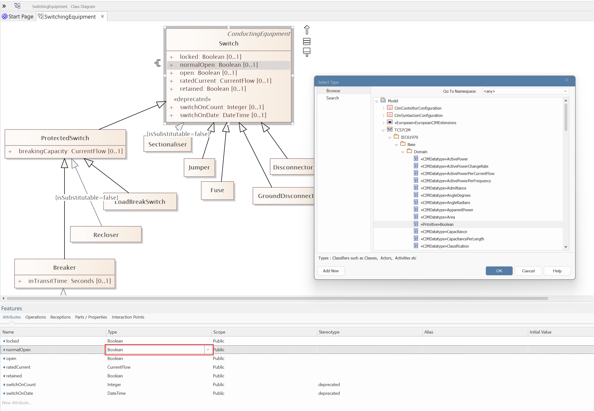
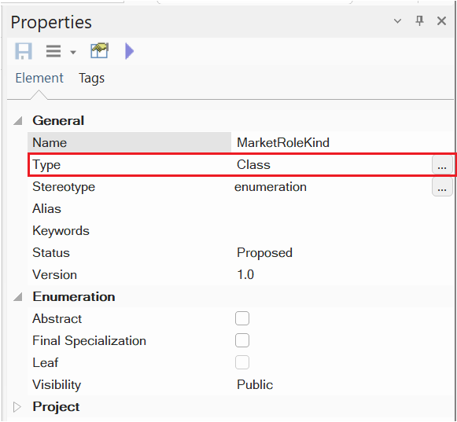
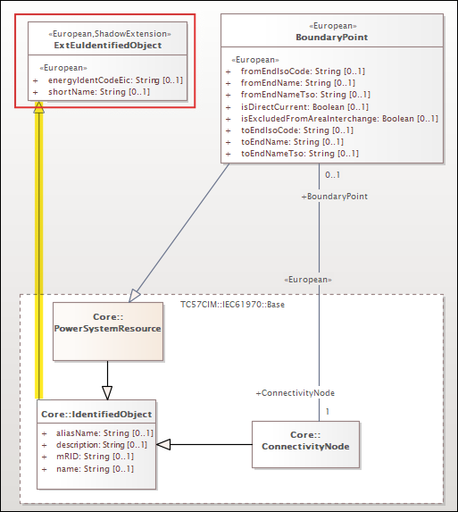
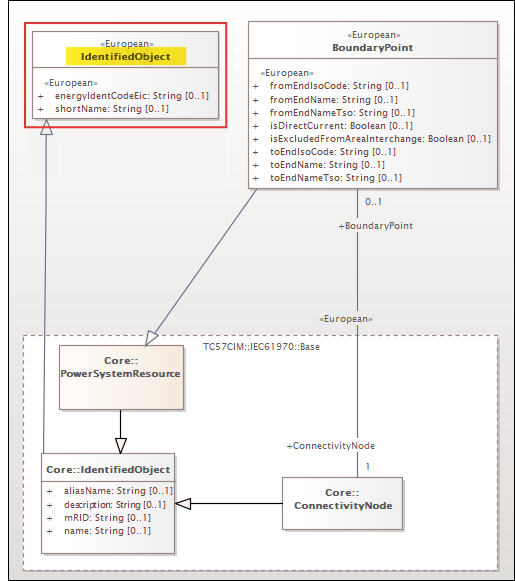
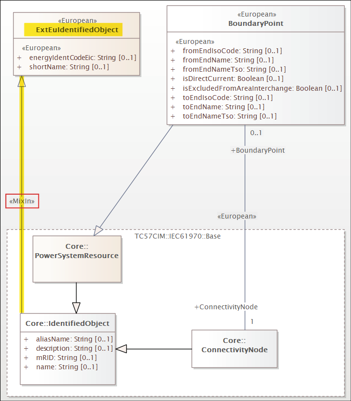
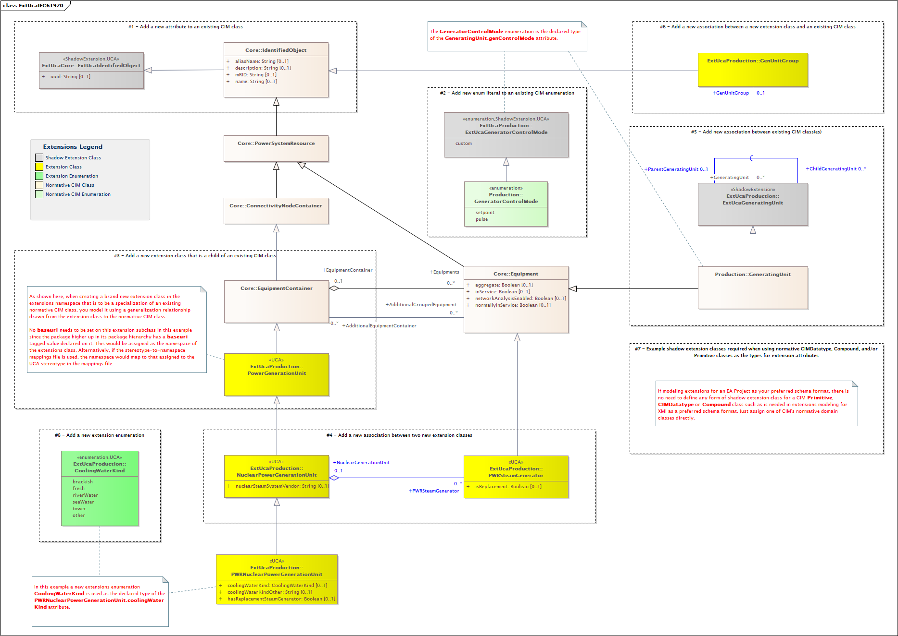
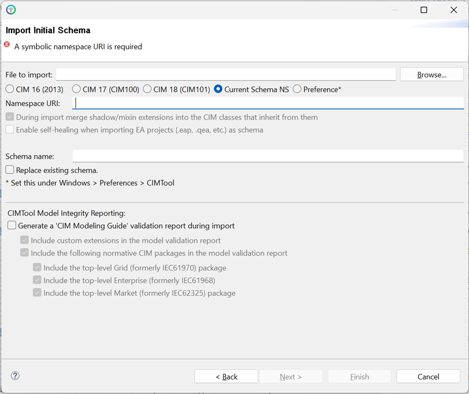
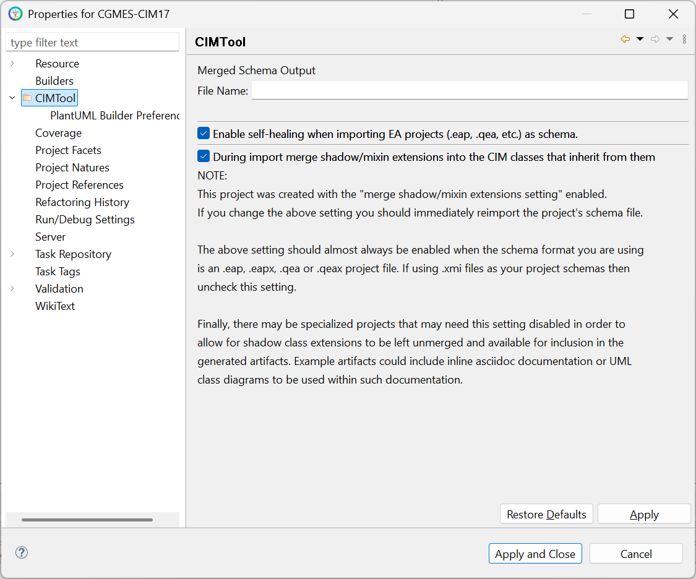
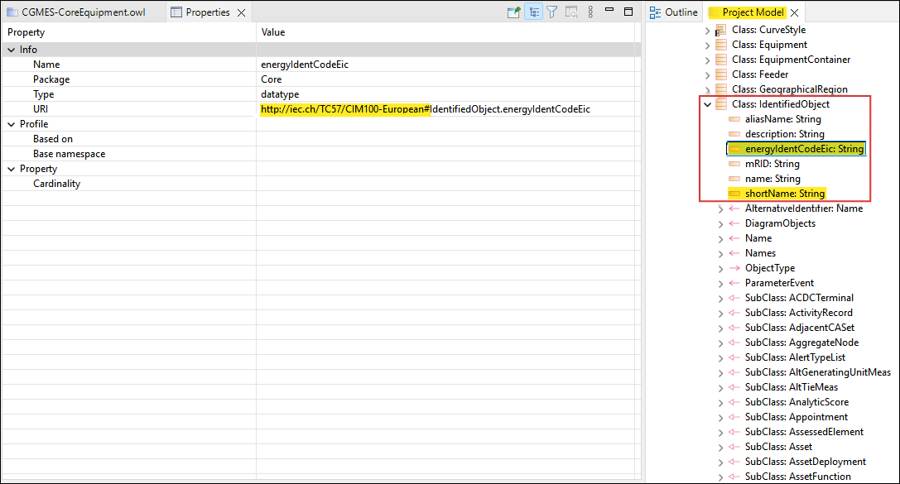
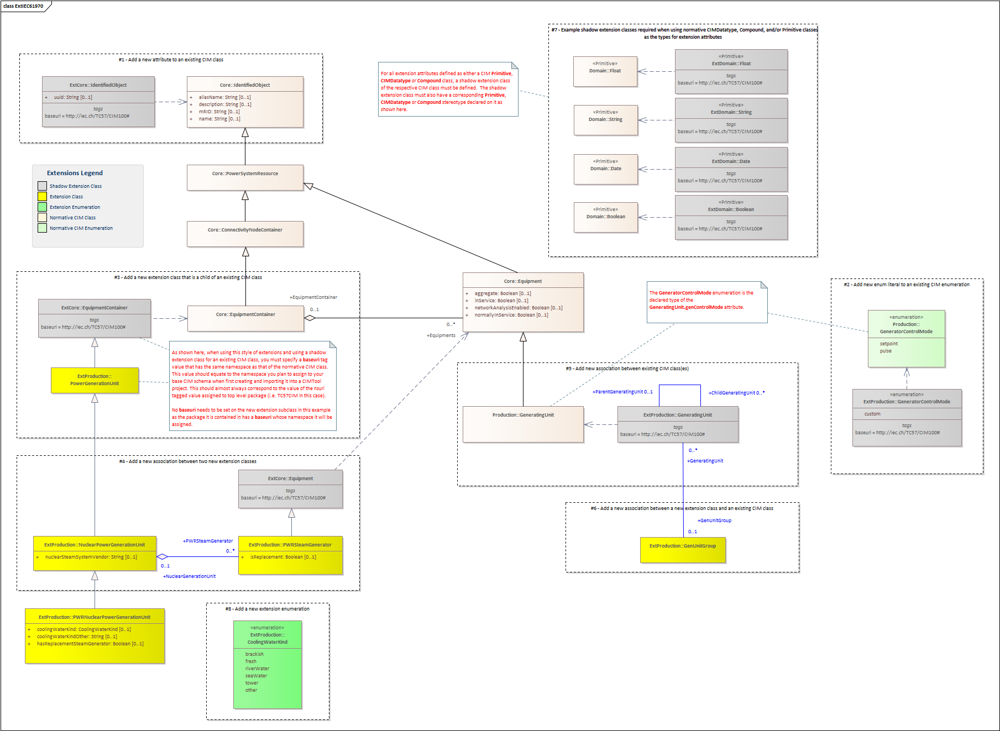

# Modeling CIM Extensions: Shadow Extension Classes and Mix-Ins

The CIM is routinely extended by standards bodies, transmission system operators, and individual organizations to address domain-specific requirements not covered by the normative model. A well-established pattern for modeling such extensions, particularly when attributes or associations need to be contributed to an existing normative CIM class under a distinct namespace, is the use of **shadow classes**.

In addition to existing support for shadow classes, **CIMTool** 2.3.0 introduces two additional ways of supporting this pattern through two new UML stereotypes: `«ShadowExtension»` and `«MixIn»`. These options for expressing shadow extension classes are intended to be in addition to the extension modeling conventions described in the [CIM Modeling Guide Section 6.1.2](https://cim-mg.ucaiug.io/latest/section6-cim-uml-extension-rules-and-recommendations/#custom-cim-extensions) (Custom CIM Extensions). A future release of the CIM Modeling Guide will be updated to reflect how these stereotypes complement and support the existing guidelines and conventions specifically within the context where the direct use of Sparx EA project files is preferred.

For details on how extension namespaces are assigned in **CIMTool**, see [CIMTool Support for Extension Namespaces](cimtool-support-for-extension-namespaces.md).

**CIMTool** supports two approaches to modeling user defined extensions to the normative CIM, depending on the schema format a project uses:

- **Sparx EA project file** (`.eap`, `.eapx`, `.qea` or `.qeax`): shadow extension classes and mix-ins, described in [Modeling Extensions in an EA Project File](#modeling-extensions-in-an-ea-project-file).
- **XMI exported from Sparx EA**: shadow classes joined to the CIM by a shared namespace, described in [Modeling Extensions for XMI Schemas](#modeling-extensions-for-xmi-schemas).

Neither approach is right or wrong, but they are modeled differently, so choose one before you start (see [Choosing a Preferred Schema Format Up Front](#choosing-a-preferred-schema-format-up-front)).

## Choosing a Preferred Schema Format Up Front

This choice matters when you maintain your own Golden Copy of the normative CIM, with local extensions for your organization's needs.

### Things to Consider

Both formats start from the same Sparx EA model, and **CIMTool** can profile either one. They differ in how the schema reaches **CIMTool**, how extensions must be modeled, and what **CIMTool** can do with the model on import. The table below compares the two, consideration by consideration.

<table>
<thead>
<tr><th>Consideration</th><th>EA project file (<code>.eap</code>, <code>.eapx</code>, <code>.qea</code>, <code>.qeax</code>)</th><th>XMI exported from EA</th></tr>
</thead>
<tbody>
<tr><td><strong>Getting the schema into CIMTool</strong></td>
<td>CIMTool reads the EA project file directly. There's no export step and no risk of a stale export. Sparx EA isn't needed to read the file: anyone with an EA project file, such as a published CIM release, can profile it with CIMTool alone, which is open source and free of charge.</td>
<td>Requires an export from EA every time the model changes, with the correct export settings. A missed re-export means profiling against an out-of-date schema. Exporting XMI needs the full, paid edition of Sparx EA; the free edition can't export.</td></tr>
<tr><td><strong>Where extensions are modeled</strong></td>
<td>In the same EA project file as the normative CIM itself, commonly as top-level packages alongside the top-level normative CIM package. A common convention is to have each top-level extension package correspond to one extension namespace. CIMTool supports two ways of assigning it: a <code>baseuri</code> tagged value on the package (see <a href="../cimtool-support-for-extension-namespaces/#approach-1-uml-tag-baseuri">UML Tag: baseuri</a>), or a stereotype-to-namespace mappings file, <code>.namespaces</code> (see <a href="../cimtool-support-for-extension-namespaces/#approach-2-stereotype-to-namespace-mappings-file">Stereotype-to-Namespace Mappings File</a>). That makes extensions easy to organize by the namespace they live within, and makes it clear which namespace a package belongs to. Although this is a common convention, someone who chooses to mix extensions for different namespaces within sub-packages of a top-level extension package must know how to use CIMTool's namespace features to override a namespace defined higher in the package hierarchy (see <a href="../cimtool-support-for-extension-namespaces/">CIMTool Support for Extension Namespaces</a>). A CIMTool project holds one EA project file.</td>
<td>Usually the same: top-level packages beside the CIM in one EA project, each exported as its own XMI file with its own namespace. However, extensions from different parties, maintained in their own separate models and under different lifecycles, can also be imported as XMI to sit side by side. Namespaces are assigned with <code>baseuri</code> tagged values (see <a href="../cimtool-support-for-extension-namespaces/#uml-tag-baseuri">UML Tag: baseuri</a>). The stereotype-to-namespace mappings file (<code>.namespaces</code>) applies only to EA project files.</td></tr>
<tr><td><strong>How shadow classes are modeled</strong></td>
<td>A shadow class adds attributes or associations to a normative CIM class from another namespace. In an EA project file, the normative CIM class always inherits from the shadow class through a UML generalization, drawn from the normative CIM class to the shadow class. The shadow class is identified in one of three ways (see <a href="#options-for-defining-a-shadow-class">Options for Defining a Shadow Class</a>):
<ul>
<li><strong><code>«ShadowExtension»</code> stereotype.</strong> The shadow class has its own name, by convention prefixed <code>Ext</code> (for example <code>ExtEuIdentifiedObject</code>), and carries the <code>«ShadowExtension»</code> stereotype (see <a href="#variant-1-explicit-shadowextension-stereotype">Variant 1</a>). The stereotype is especially useful for an existing model whose shadow classes use a naming prefix, or, as is often the case, a mix of prefixed and same-named classes. Applying the stereotype to every class meant to serve as a shadow class removes any ambiguity for CIMTool. For a model that uses a naming prefix, such as CGMES, this step is mandatory: tag all of its shadow classes with <code>«ShadowExtension»</code> before importing the model.</li>
<li><strong>Same-named class in another namespace.</strong> The shadow class has exactly the same name as the normative CIM class it shadows, with a different namespace set by a <code>baseuri</code> tagged value or a <code>.namespaces</code> file. No stereotype is needed: CIMTool recognizes a class as a shadow class when its namespace differs from that of the normative CIM class with the same name. This suits a model in which every shadow class follows that naming convention (see <a href="#variant-2-same-named-class-with-a-distinct-namespace">Variant 2</a>).</li>
<li><strong><code>«MixIn»</code> generalization.</strong> The shadow class may have its own name. The generalization carries the <code>«MixIn»</code> stereotype, so the class itself needs none (see <a href="#variant-3-mixin-stereotype-on-the-generalization">Variant 3</a>).</li>
</ul>
CIMTool supports all three, and merges them the same way on import. As a best practice, choose one of the three conventions for your model and use it throughout, rather than mixing them.</td>
<td>A shadow class has the same name as the normative CIM class and sits in an extension package. Its <code>baseuri</code> tagged value is set to the normative CIM namespace, so CIMTool treats it and the CIM class as one class. That namespace is the one given to the base CIM schema at import. A dependency drawn from the shadow class to the CIM class shows the relationship on the diagram; CIMTool doesn't read it. The shadow class carries no stereotype, because a stereotype would be merged into the normative class. New attributes and enumeration literals on a shadow class take the namespace of their package; the shadow class's <code>baseuri</code> applies to the class only.</td></tr>
<tr><td><strong>How CIMTool combines them</strong></td>
<td>Merged on import, with the "During import merge shadow/mixin extensions into the CIM classes that inherit from them" checkbox checked, normally when creating the project (see <a href="#enabling-shadow-class-merging-in-cimtool">Enabling Shadow Class Merging in CIMTool</a>): CIMTool recognizes the variants and moves the members into the CIM class.</td>
<td>Combined in the union of the schemas, with the same checkbox required to be unchecked: the shared URI makes the shadow class and the CIM class one class. This depends on <code>baseuri</code> being set correctly.</td></tr>
<tr><td><strong>Relationships to CIM classes</strong></td>
<td>Extension classes are in the same model as the CIM, so they can generalize, and associate with, normative CIM classes directly. For example, CGMES draws <code>BoundaryPoint</code> → <code>Core::PowerSystemResource</code>. Shadow classes are needed only to add attributes or associations to an existing CIM class, or literals to an existing enumeration.</td>
<td><strong>Trade-off:</strong> extension classes can't connect to a normative CIM class directly. Every generalization and association goes through a shadow/proxy class of that CIM class (see <a href="#the-eight-extension-types">the eight extension types</a>). A direct link to a class outside the exported package doesn't survive the export, and the class is left with no parent. Choosing XMI therefore means modeling extensions this way from the start, and an existing model such as CGMES has to be redrawn: for example, its generalization <code>Core::IdentifiedObject</code> → <code>ExtEuIdentifiedObject</code> is replaced with a shadow <code>IdentifiedObject</code>.</td></tr>
<tr><td><strong>Self-healing on import</strong></td>
<td>Available. With the "Enable self-healing when importing EA projects (.eap, .qea, etc.) as schema" checkbox checked on import, CIMTool works around two common problems in the CIM UML model as it reads the EA project file:
<ul>
<li><strong>Orphaned classifiers:</strong> in EA, an attribute's type can be typed in by hand, for example <code>String</code>, but EA links the attribute to that type only when the type is chosen in the type (classifier) browser. A typed-in name shows on the diagram while the link in the EA project file stays empty. CIMTool matches the type by name to the CIM type that exists in the model, and maps EA's native types to their CIM equivalents where it can.</li>
<li><strong>Enumerations of the wrong element type:</strong> the CIM Modeling Guidelines require an enumeration to be modeled as a Class with the <code>«enumeration»</code> stereotype (the element's Type is <code>Class</code>). An enumeration created as EA's Enumeration element, with Type <code>Enumeration</code>, does not conform and would otherwise break in CIMTool. Self-healing maps it to the correct form when the schema is translated into CIMTool's internal OWL representation, so it can be profiled.</li>
</ul>
Self-healing does not change the EA project file itself. It makes the model usable for profiling, on the expectation that the underlying problems are fixed in the model as they are identified. The import's validation report lists each correction. See <a href="#what-self-healing-corrects">what self-healing corrects</a>, below the table, for examples in Sparx EA.</td>
<td>Not available. These problems must be fixed in the EA model before it is exported.</td></tr>
<tr><td><strong>Comparing model versions</strong></td>
<td>cim-compare reads EA project files directly, which needs a licensed EA installation.</td>
<td>cim-compare reads XMI exported as "UML 1.3 (XMI 1.1)".</td></tr>
<tr><td><strong>File size</strong></td>
<td>One compact database file, diagrams included. For example, the full CIM17 release (<code>iec61970cim17v40_iec61968cim13v13b_iec62325cim03v17b_CIM100.1.1.1.qea</code>, 682 diagrams) is about 41 MB.</td>
<td>Large text files. For example, an XMI export of the same CIM17v40 model, without any diagrams, is about 106 MB, roughly two and a half times the size of the <code>.qea</code>, and every re-export rewrites it in full.</td></tr>
<tr><td><strong>Changing extensions modeling approach later</strong></td>
<td colspan="2">Means remodeling every shadow class, so decide up front. From XMI to an EA project file, each <code>baseuri</code>-tagged shadow class and its dependency is replaced with one of the three EA variants, using a generalization from the normative CIM class. From an EA project file to XMI, the reverse, and every direct relationship between an extension class and a CIM class must also be redrawn.</td></tr>
</tbody>
</table>

<a id="what-self-healing-corrects"></a>

??? example "What self-healing corrects: examples in Sparx EA"

    **Orphaned classifiers.** Choose an attribute's type in EA's type (classifier) browser rather than typing its name. Below, the type of `normalOpen` (outlined in red) is being chosen in the "Select Type" dialog, which links the attribute to the `«Primitive»` `Boolean` class in the model. The CIM Modeling Guide requires attribute data types to be stereotyped CIM classes rather than Enterprise Architect's native data types ([Rule055](https://cim-mg.ucaiug.io/latest/section5-cim-uml-modeling-rules-and-recommendations/#Rule055)), and recommends selecting the type from the list of existing types rather than typing its name.

    [](../images/SelfHealingClassifierBrowser.png "Click to view at full size")
    **Enumerations.** A correctly modeled CIM enumeration: the element's "Type" field is `Class` (outlined in red) and its "Stereotype" field is `«enumeration»`. This is the form the CIM Modeling Guide requires: "A CIM enumeration shall be a UML class with the `«enumeration»` stereotype" ([Rule084](https://cim-mg.ucaiug.io/latest/section5-cim-uml-modeling-rules-and-recommendations/#Rule084)). An element whose Type is `Enumeration` is what self-healing corrects on import.

    [](../images/SelfHealingEnumerationType.png "Click to view at full size")
In summary:

- **XMI:** extensions must be modeled through shadow/proxy classes throughout, and existing extension models may need to be redrawn.
- **EA project file:** **CIMTool** reads the model directly, with no export step and no EA licence needed to profile it. A project holds one EA project file as its base CIM schema; further extensions can be added alongside it in other schema files, such as an OWL vocabulary.


**Either format:** mapping files, created with the New Mappings wizard and edited in the Mapping Editor, relate classes and properties across schemas without editing either model. They work the same way with an EA project file or with XMI.

**Other schema formats:** **CIMTool** can also read OWL (RDF) files and Ecore models (`.ecore`, `.ecore-registry`) as schemas. Both are rarely used. An OWL file can serve as the base CIM schema, or add classes and properties alongside an EA project file or XMI; extensions in OWL are written directly in their own namespace, without shadow classes or `baseuri` tagged values. `cimtool-cli` cannot yet build a project whose schema includes either format.

!!! warning "CGMES counts as a model with extensions"

    CGMES is published as part of the IEC standards, but its European extensions are a regional standard, defined in their own namespace (`http://iec.ch/TC57/CIM100-European#`), extending the normative CIM. The same applies to ENTSO-E's Network Codes modeling, which is defined in its own namespace (`http://entsoe.eu/ns/nc#`). Both extend the normative CIM just as local extensions do. If you work with CGMES, the choice of schema format therefore matters even when you add no extensions of your own: ENTSO-E models both the European and the Network Codes extensions in the EA project file style, and using them as XMI means remodeling them in the XMI style first. The **CIMTool** in-product help, under **Help > Help Contents > Modeling Extensions in the CIM**, walks through that remodeling for the CGMES European extensions, with the XMI and EA project file diagrams side by side.

## Modeling Extensions in an EA Project File

### How Shadow Classes Work in an EA Project File

A shadow class is not a real class in the model in the conventional sense. Rather, it is a construct that "shadows" a normative CIM class, contributing attributes or associations to that class under a different namespace. When **CIMTool** processes a shadow class with merging enabled, it transparently folds the shadow class's members into the normative CIM class in its internal in-memory OWL representation. The shadow class itself disappears, and its attributes and associations appear as members of the normative class but in the extension namespace.

The practical outcome is illustrated in the following instance data example, where the European `shortName` and `energyIdentCodeEic` attributes are contributed to `IdentifiedObject` under the `eu:` namespace:

```xml
<rdf:RDF xmlns:cim="http://iec.ch/TC57/CIM100#"
    xmlns:md="http://iec.ch/TC57/61970-552/ModelDescription/1#"
    xmlns:eu="http://iec.ch/TC57/CIM100-European#">

  <cim:Substation rdf:ID="_87f7002b-056f-4a6a-a872-1744eea757e3">
    <cim:IdentifiedObject.name>Anvers</cim:IdentifiedObject.name>
    <eu:IdentifiedObject.shortName>Anvers</eu:IdentifiedObject.shortName>
    <cim:Substation.Region rdf:resource="#_02047c0b-b5a4-4e0d-bae6-fc5437a55e74" />
    <cim:IdentifiedObject.mRID>87f7002b-056f-4a6a-a872-1744eea757e3</cim:IdentifiedObject.mRID>
  </cim:Substation>

</rdf:RDF>
```

### Options for Defining a Shadow Class

**CIMTool** recognises three variants of the shadow class pattern. All three produce the same merging behavior when the merge setting is enabled, differing only in how the shadow class is declared in the UML.

#### Variant 1: Explicit `«ShadowExtension»` Stereotype

The shadow class is given a name distinct from the normative CIM class it shadows (conventionally prefixed with `Ext`) and is decorated with the `«ShadowExtension»` stereotype. A generalization, drawn from the normative CIM class to the shadow class, connects the two. The `«European»` stereotype on the class (or a `baseuri` tagged value specified within the class's package hierarchy) identifies its namespace.

[](../images/ShadowExtensionExplicitStereotype.png "Click to view at full size")
In the example above, `ExtEuIdentifiedObject` shadows `IdentifiedObject`. Its `shortName` and `energyIdentCodeEic` attributes will be merged into `IdentifiedObject` under the European namespace.

!!! note

    When viewing a UML diagram containing a `«ShadowExtension»` class, the generalization relationship between the normative CIM class and the shadow class may at first glance appear to introduce multiple inheritance on that normative class. This appearance is intentional by design and is not conventional multiple inheritance in the broader UML sense. The [CIM Modeling Guide Section 5.10](https://cim-mg.ucaiug.io/latest/section5-cim-uml-modeling-rules-and-recommendations/#inheritance-rules) states that *"the use of multiple inheritance is not allowed (except as specified for extensions)"*, and [Section 6.1.2](https://cim-mg.ucaiug.io/latest/section6-cim-uml-extension-rules-and-recommendations/#custom-cim-extensions) explicitly acknowledges that *"the standard CIM class will now have multiple inheritance"* as a result of the shadow class pattern, noting this as a sanctioned exception specific to extension modeling. When processed by **CIMTool** with merging enabled, the shadow class is merged into the normative class, its members becoming members of the normative class, so the apparent multiple inheritance relationship exists only transiently in the UML and has no bearing on the generated artifacts.

#### Variant 2: Same-Named Class with a Distinct Namespace

The shadow class is given the exact same name as the normative CIM class it shadows. **CIMTool** implicitly identifies it as a shadow class because it has an identical name but a different namespace, that namespace being determined by whichever mechanism is in use for the project: either a `baseuri` tagged value specified within the class's package hierarchy (on the class itself or on a package above it), or a stereotype-to-namespace mapping defined in a `.namespaces` file for the schema. In the example below, the `«European»` stereotype on the class identifies its namespace. No explicit `«ShadowExtension»` stereotype is required for **CIMTool** to recognise this variant. Note that this variant is the one with the longest history while variants #1 and #3 added in recent years are what you will see most commonly used in current models used with CIMTool.

[](../images/ShadowExtensionSameNamedClass.png "Click to view at full size")
#### Variant 3: `«MixIn»` Stereotype on the Generalization

The shadow class may have a distinct name (as in Variant 1) but the generalization relationship connecting it to the normative CIM class is decorated with the `«MixIn»` stereotype. This explicitly flags the parent as a shadow extension without requiring the `«ShadowExtension»` stereotype on the class itself.

[](../images/ShadowExtensionMixInStereotype.png "Click to view at full size")
### The Eight Extension Types in an EA Project File

The diagram below models the same eight kinds of extension as the diagram in [Modeling Extensions for XMI Schemas](#modeling-extensions-for-xmi-schemas), this time with an EA project file as the preferred schema format, so the two approaches can be compared side by side. Click the diagram to view it at full size.

[](../images/ModelingExtensionsEACheatSheet.png "Click to view at full size")

Compared with the XMI approach:

- Shadow classes (#1 and #5) and shadow enumerations (#2) carry the `«ShadowExtension»` stereotype, and the normative CIM class or enumeration generalizes them. A new literal for an existing enumeration (#2) is added to a shadow enumeration in this way.
- A new extension class can generalize a normative CIM class directly (#3, #4 and #6), with no shadow class in between.
- Extension attributes use CIM's normative `«Primitive»`, `«CIMDatatype»` and `«Compound»` classes as their types directly (#7); no shadow types are needed.
- The `«UCA»` stereotype on the extension classes assigns their namespace through a stereotype-to-namespace mappings file (`.namespaces`); a `baseuri` tagged value within the package hierarchy works as well.

### Enabling Shadow Class Merging in CIMTool

Shadow class merging is controlled by a project-level setting that must be enabled for **CIMTool** to process shadow classes and fold their members into the normative CIM classes they shadow.

#### During New Project Creation

The merge setting is available on the "Import Initial Schema" step of the **New Project** wizard. Check the "During import merge shadow/mixin extensions into the CIM classes that inherit from them" checkbox to enable it before completing the wizard.

[](../images/ImportSchemaDialogMergeCheckbox.png "Click to view at full size")
!!! note

    This setting does not appear on the "Import Schema" dialog used when re-importing or replacing a schema in an existing project. For existing projects, use the **Properties** dialog described below.

#### After Project Creation

The setting can also be changed after a project has been created via the project's "Properties" dialog, accessible by right-clicking the project in the Project Explorer and selecting "Properties". In practice this is rarely needed, the most common scenario being correcting an initial import where the setting was inadvertently left unchecked.

!!! note

    This setting should always be enabled when your project schema is a Sparx EA project file (`.eap`, `.eapx`, `.qea`, or `.qeax`). If your project uses `.xmi` files as its schema, uncheck this setting.

[](../images/ProjectPropertiesMergeSetting.png "Click to view at full size")
!!! warning

    If you change this setting after a project has been created you should immediately re-import the project's schema file for the change to take effect.

### Result: Merged Attributes in the Project Model

When merging is enabled and the schema is imported, shadow class members appear directly under their normative CIM parent class in the **CIMTool** Project Model view. The screenshot below shows `energyIdentCodeEic` and `shortName` appearing as members of `IdentifiedObject`, with their URI reflecting the European extension namespace:

[](../images/ProjectModelMergedExtensionAttributes.png "Click to view at full size")
## Modeling Extensions for XMI Schemas

When a project's schema is XMI exported from Sparx EA, extensions are modeled with shadow classes of a different kind. An XMI shadow class has exactly the same name as the normative CIM class it shadows and sits in an extension package. Its `baseuri` tagged value is set to the normative CIM namespace, the one given to the base CIM schema at import, so **CIMTool** treats it and the CIM class as one class when it combines the schemas. Nothing is merged on import: leave the merge setting unchecked for XMI (see [Enabling Shadow Class Merging in CIMTool](#enabling-shadow-class-merging-in-cimtool)).

The diagram below shows each kind of extension modeled in this style. Click the diagram to view it at full size. For the same eight extension types modeled in an EA project file, see [The Eight Extension Types in an EA Project File](#the-eight-extension-types-in-an-ea-project-file).

[](../images/ModelingExtensionsXMICheatSheet.png "Click to view at full size")
### The Eight Extension Types

| # | Extension type | How it's modeled |
|---|---|---|
| 1 | Add a new attribute to an existing CIM class | A shadow class (`ExtCore::IdentifiedObject`, `baseuri` = CIM namespace) holds the new attribute (`uuid`), with a dependency to the normative class |
| 2 | Add a new literal to an existing CIM enumeration | A shadow enumeration (`ExtProduction::GeneratorControlMode`, `baseuri` = CIM namespace) holds the new literal (`custom`) |
| 3 | Add a new extension class that is a child of an existing CIM class | The new class (`PowerGenerationUnit`) generalizes a shadow of the parent (`ExtCore::EquipmentContainer`), never the normative class. It needs no `baseuri` of its own, because its package supplies the extension namespace |
| 4 | Add a new association between two new extension classes | A plain association (`NuclearPowerGenerationUnit` and `PWRSteamGenerator`); `PWRSteamGenerator` generalizes the shadow `ExtCore::Equipment` |
| 5 | Add a new association between existing CIM classes | Drawn on a shadow (`ExtProduction::GeneratingUnit`, self-association `ParentGeneratingUnit`/`ChildGeneratingUnit`) |
| 6 | Add a new association between a new extension class and an existing CIM class | From the new class (`GenUnitGroup`) to a shadow of the CIM class (`ExtProduction::GeneratingUnit`) |
| 7 | Use a normative Primitive, CIMDatatype or Compound as the type of an extension attribute | A shadow of the type (`ExtDomain::Float`, `String`, `Date`, `Boolean`) carrying the same stereotype as the normative type |
| 8 | Add a new extension enumeration | A new enumeration in an extension package (`ExtProduction::CoolingWaterKind`), used as the type of an extension attribute (`PWRNuclearPowerGenerationUnit.coolingWaterKind`) |

!!! warning "Type extension attributes with the shadow type"

    When you choose the type of an extension attribute in EA's type (classifier) browser, select the shadow type in your extension package (for example `ExtDomain::Boolean`), never the normative `«Primitive»`, `«CIMDatatype»` or `«Compound»` class in the CIM `Domain` package. A type reference to a class outside the exported package is typically lost in the export, leaving the attribute with an orphaned type, and self-healing on import is not available for XMI.

### Rules

- Every shadow class has `baseuri` set to the normative CIM namespace, which is the namespace given to the base CIM schema at import.
- An extension class never generalizes or associates directly to a normative CIM class, but always through a shadow class. A direct link to a class outside the exported package is lost in the export, and the class is left with no parent.
- Shadow classes carry no class stereotype. Put stereotypes on the extension attributes instead, because a stereotype on a shadow class is merged into the normative CIM class (for example `«European»` would appear on `IdentifiedObject`).
- New attributes and enumeration literals on a shadow class take the namespace of their package; the shadow class's `baseuri` applies to the class only. An attribute-level `baseuri` is optional and overrides the package namespace.
- Namespaces for XMI are assigned with `baseuri` tagged values. The stereotype-to-namespace mappings file (`.namespaces`) applies only to EA project files. If you receive an XMI file whose model has no `baseuri` tagged values, an annotation file can supply them (see [CIMTool Support for Extension Namespaces](cimtool-support-for-extension-namespaces.md)).

!!! warning "The arrow points the other way"

    How a shadow class is joined to its normative CIM class depends on the schema format you choose, even though both kinds of model are drawn in Sparx EA. If your preferred schema format is the EA project file, then in your extensions modeling the shadow class is joined by a generalization drawn from the normative CIM class to the shadow class. If your preferred schema format is XMI, then in your extensions modeling it is joined by a dependency drawn from the shadow class to the normative CIM class, and that dependency only visualizes the loose relationship created when the two classes are combined in the union during import. Using the wrong relationship, or drawing it in the wrong direction, produces an error for the EA project file format but not for the XMI format. Use the relationship and direction that match the schema format you choose, especially when following examples or diagrams drawn for the other format.

## Further Reading

The extension modeling conventions underpinning the shadow class pattern are described in detail in the [CIM Modeling Guide](https://cim-mg.ucaiug.io/latest/), specifically:

- [Section 6.1.2: Custom CIM Extensions](https://cim-mg.ucaiug.io/latest/section6-cim-uml-extension-rules-and-recommendations/#custom-cim-extensions): covers the use of shadow classes, the `«CIMExtension»` generalization stereotype, and association modeling guidance for extensions.
- [Section 6.6: Association Extension Rules](https://cim-mg.ucaiug.io/latest/section6-cim-uml-extension-rules-and-recommendations/#association-extension-rules): covers [Rule204](https://cim-mg.ucaiug.io/latest/section6-cim-uml-extension-rules-and-recommendations/#Rule204) and best practices for modeling associations between extension classes and normative CIM classes.

For guidance on assigning extension namespaces in **CIMTool**, including the `baseuri` tagged value and the stereotype-to-namespace mappings file introduced in 2.3.0, see [CIMTool Support for Extension Namespaces](cimtool-support-for-extension-namespaces.md).

!!! note

    At present, the CIM Modeling Guide sections referenced above do not formally describe variants #1 and #3 extensions options but are planned additions in the next release of the guide.
